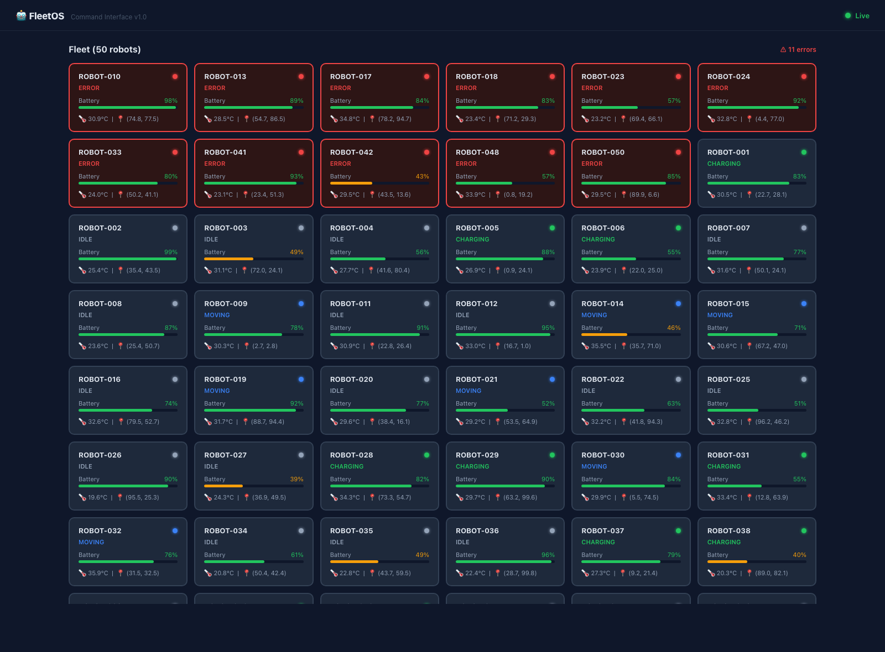
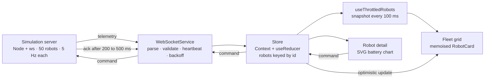

# FleetOS

A real-time command dashboard for a simulated fleet of 50 robots, each streaming telemetry at 5 Hz over one WebSocket.

[](https://github.com/samarthpaliwal/robotics-fleet-ui/actions/workflows/ci.yml)




## Problem

Fifty robots at five updates a second is about 250 messages a second arriving at one browser tab. Render
on every message and the UI spends its time repainting; wait for the server before showing a command and
the operator's controls feel dead. The connection will also drop, and the dashboard has to recover without
a reload.

## Approach



- **Normalised state.** Robots live in a map keyed by `robot_id`, so a telemetry message replaces one entry.
- **Throttled rendering.** The grid reads a snapshot taken every 100 ms instead of re-rendering on each
  message, and `RobotCard` is wrapped in `React.memo` so one robot's update does not repaint the others.
- **Optimistic commands.** START, STOP, RETURN_TO_BASE and EMERGENCY_STOP set the expected status
  immediately and mark the card pending; the server's acknowledgement clears it.
- **A socket that recovers.** A framework-free `WebSocketService` owns the connection: JSON validation, a
  15 s heartbeat, and reconnection with exponential backoff (1 s base, 30 s cap, up to 500 ms jitter).
- **No charting library.** The battery history is a hand-written SVG path over the last 30 readings.

The server staggers each robot's timer (200 ms plus 4 ms per robot) so broadcasts are spread out rather
than arriving in bursts.

## Results

- 50 robots at 5 Hz each, about 250 telemetry messages a second, rendered at about 10 frames a second by
  the throttled snapshot. These are the simulator's configured rates, not a benchmark.
- Stopping and restarting the server reconnects the dashboard without a reload.
- Production bundle: 155 kB of JavaScript (50 kB gzipped). Runtime dependencies are React and React DOM only.

Limits: commands are acknowledged by the simulator but do not change the simulated robot's state on the
server, and there are no automated tests yet; CI type-checks and builds.

## Quick start

Requires Node.js 18 or newer.

```bash
git clone https://github.com/samarthpaliwal/robotics-fleet-ui.git
cd robotics-fleet-ui
npm install
```

Terminal 1, the simulation server on `ws://localhost:8080`:

```bash
npm run server
```

Terminal 2, the dashboard on http://localhost:5173:

```bash
npm run dev
```

Click a card to open the detail panel with live telemetry, the battery chart and the command buttons.

Production build (type-check, then bundle to `dist/`):

```bash
npm run build
```

To point the dashboard at another server, copy `.env.example` to `.env` and set `VITE_WS_URL`. The
server's port, robot count and tick interval are constants at the top of `server/simulationServer.ts`.

## Tech stack

React 18, TypeScript, Vite, Node.js, `ws`.

## Project structure

```
robotics-fleet-ui/
├── server/simulationServer.ts     ws-based telemetry simulator, port 8080
├── src/
│   ├── App.tsx                    header, fleet grid, optional detail panel
│   ├── types/robot.ts             telemetry, command and message types
│   ├── services/websocketService.ts
│   ├── store/                     RobotContext.tsx, robotReducer.ts
│   ├── hooks/                     useWebSocket.ts, useThrottledRobots.ts
│   └── components/
│       ├── FleetOverview/         grid and RobotCard
│       ├── RobotDetail/           detail panel and BatteryChart
│       ├── CommandPanel/
│       └── ConnectionStatus/
├── docs/dashboard.png
├── .env.example
└── vite.config.ts
```
